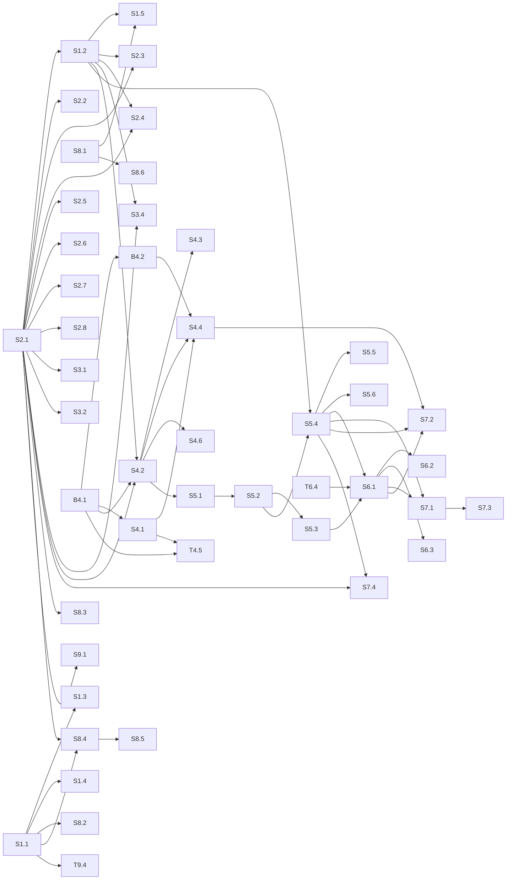

# CyberAsset Guard — Jira Backlog

Generated 2026-10-13 from the repository `the project repository`. **No Jira issues were created**: no Jira
integration (MCP connector, CLI or API credentials) is available in this environment. This document and
`jira-import.csv` form an import-ready backlog.

Legend: ✅ **verified** = checked in code and/or by running tests · *(estimate)* = story points or effort
are estimates · **assumption** = not verifiable from the repository.

## 1. Current implementation assessment

### Repository state (verified)

| Ref | Branch | Where | Content | Tests |
|---|---|---|---|---|
| `ff0dbc7` | `main` (= `origin/main`, `origin/monitoring-part5`) | GitHub | Monitoring parts 1–5, Asset Management, infrastructure | **87 tests: 86 passed, 1 skipped** (Docker test, opt-in) — run 2026-10-13 |
| `453d973` | `feature/auth-rbac-audit` | **local only, not pushed, not reviewed** | + login, RBAC, audit log | **154 tests passed incl. Docker** — run 2026-10-13 |
| `ae26506` | `feature/correlation-risk-action` | local only | unreviewed prototype of correlation/risk/Jira (old data model) | not on main; **not counted as done** |

Stack (verified): Python ≥ 3.11 (tested on 3.13), FastAPI, SQLAlchemy 2 (assets, auth, audit) + plain
`sqlite3` (Monitoring), SQLite single file, APScheduler, Nmap via subprocess, static HTML/JS/CSS UI without
build step, Docker + Compose. ~4,250 lines in `app/`.

### Completed work (verified — no new stories created)

| Area | Implemented | Evidence |
|---|---|---|
| Monitoring (block 2) | Nmap discovery, port scan, version scan, scheduled scans (persisted), change detection, CLI | `app/monitoring/*`, commits `c7c2ae8`…`d68d855`; **only indirectly tested** (see gaps) |
| Asset inventory (block 1) | UUID identity, required/optional fields with controlled values (API + DB CHECK constraints), tags table, create/list/search/filter/sort/page/get/update, deactivate/activate (no delete), web UI (overview, detail with 6 sections, add/edit form, validation messages) | `app/assets/*`, `app/web/*`, `tests/test_assets.py` (50 tests incl. parametrised) |
| Infrastructure | Config validation with clear errors, `.env.example`, runtime/dev requirements + `constraints.txt`, liveness/readiness endpoints, logging, generic error responses, `busy_timeout`, `python -m app.maintenance` (check, init-db, backup via SQLite online backup, verify, restore without silent overwrite), Dockerfile (non-root, healthcheck), Compose (localhost port, data + backup volumes) | `tests/test_infrastructure.py` (37 tests incl. real Uvicorn restart and Docker test) |
| Authentication & access (branch only) | scrypt hashing, password policy, server-side sessions (HttpOnly/SameSite=Strict, token hash stored), idle + absolute expiry, lockout, no user enumeration, RBAC viewer/analyst/admin on all endpoints, last-admin protection, user management API + UI, CLI create-user/reset-password | `app/auth/*`, `tests/test_auth.py` (54 tests) — **on `feature/auth-rbac-audit` only → story `S2.1`** |
| Audit log (branch only) | Append-only (DB triggers), logins/lockouts/passwords/users/assets (field diff, same transaction)/monitoring/denied/CSRF, redaction, admin UI + API with filters | `app/audit/*`, `tests/test_audit.py` (13 tests) — **branch only → `S2.1`** |

### Remaining gaps and technical debt (verified in code)

| Gap | Evidence | Backlog |
|---|---|---|
| **Nmap argument injection**: scan targets are split on whitespace and passed to nmap unvalidated; a token starting with `-` becomes an nmap option | `app/monitoring/scanner.py` lines 168–227 (code review; not exploited — nmap not installed here) | `B4.1` |
| No restriction of scan targets to authorised networks | no allow-list in `app/monitoring` | `S4.1` |
| Schedules accept `interval_seconds >= 1`; Monitoring list `limit` unbounded | `app/monitoring/routes.py` | `B4.2` |
| No authentication on `main` (fixed on unmerged branch) | `main` routes have no auth dependency | `S2.1` |
| Monitoring hosts (`assets` table, keyed by IP) not linked to `asset_inventory` | no reference to `asset_inventory` in `app/monitoring` | `S4.2`, `S4.3` |
| No dedicated Monitoring tests (XML parsing, diff, scheduler, errors) | no test targets `app/monitoring`; only a smoke test and fake-scanner use | `S8.1` |
| No CI, lint, format, type checks, `.gitattributes` (CRLF warnings) | no `.github/`, `pyproject.toml`, `ruff`/`mypy` config | `S1.1`, `S1.3` |
| No schema migrations (`create_all` cannot alter tables) | no Alembic | `S1.2` |
| Two data-access styles (sqlite3 vs SQLAlchemy) | `app/db.py` vs `app/database.py` | `S1.5` |
| Nmap missing in Docker image | `Dockerfile` comment line 3 | `T4.5` |
| UI only tested manually | no browser tests | `S8.4` |
| No TLS profile; manual backups without retention; no audit retention | README limitations | `S9.1`, `S9.2`, `S2.6` |
| Only per-account lockout, no IP rate limit; admin-set passwords not force-changed; no API tokens | `app/auth/service.py` | `S2.2`, `S2.3`, `S2.4` |
| Distribution backports cause false positives (future CVE matching) | design limitation | `S5.6` |

### Assumptions

- The Jira project uses the standard issue types **Epic, Story, Task, Bug, Sub-task** and the priority
  scheme **Highest/High/Medium/Low**. *(assumption — verify before import)*
- Story points field exists (company-managed: "Story Points"; team-managed: "Story point estimate"). *(assumption)*
- Story points are relative estimates for a team familiar with the code base; they are **not** commitments.
- Blocks 3–5 (Vulnerability, Risk, Remediation) follow the original design slides; the local prototype branch
  is reference material only.


## 2. Proposed Jira hierarchy

| Epic | Items | Story points *(estimate)* | Scope |
|---|---|---|---|
| **E1 Application Foundation and Infrastructure** | 5 | 21 | Build, CI, schema migrations, code quality and dependency management for the FastAPI/SQLAlchemy/SQLite application. Runtime config, health checks, logging, backup and Docker exist on main; CI, migrations and quality tooling do not. |
| **E2 User and Access Management** | 8 | 43 | Authentication, role-based access control and the audit log. Implemented on branch feature/auth-rbac-audit (commit 453d973, not merged). Remaining: merge, hardening and enhancements (API tokens, rate limiting, MFA, SSO, audit retention). |
| **E3 Asset Inventory** | 4 | 15 | Central inventory of IT assets (block 1). Core CRUD, search, filtering, lifecycle and web UI are complete on main. Remaining items are improvements only. |
| **E4 Asset Monitoring** | 8 | 31 | Network discovery, ports, services, versions, scheduled scans and change detection (block 2). The Monitoring module exists on main but is not linked to managed assets, has a target-validation security gap and no dedicated tests. |
| **E5 Vulnerability Management** | 6 | 36 | Correlate identified software with CVE data (NVD, CISA KEV) and maintain asset-to-finding relationships (block 3). Not implemented on main. An unreviewed prototype exists only on the local branch feature/correlation-risk-action and may be used as reference. |
| **E6 Context-Aware Risk Engine** | 4 | 15 | Explainable risk score combining CVSS, exposure, criticality, environment and exploitability (block 4). Not implemented on main. |
| **E7 Remediation and Verification** | 4 | 26 | Jira ticket creation, remediation status and re-scan verification (block 5), plus future SIEM integration. Not implemented on main. |
| **E8 Security and Quality Assurance** | 6 | 24 | Cross-cutting security reviews, automated security scanning and test gaps for existing functionality (Monitoring module, browser UI). |
| **E9 Deployment, Operations and Maintenance** | 5 | 13 | Production-like deployment (TLS), scheduled backups, logging operations, releases and repository hygiene. Local MVP deployment (Docker, health checks, manual backup) exists on main. |

Total: 9 epics, 50 stories/tasks/bugs, 7 sub-tasks, 224 story points *(estimate)*.

```text
E1  Application Foundation and Infrastructure
  ├─ S1.1   [Task] Set up CI pipeline for tests and Docker build
  ├─ S1.2   [Task] Introduce Alembic schema migrations with a baseline of the current schema
  ├─ S1.3   [Task] Add linting, formatting and type checking
  ├─ S1.4   [Task] Automate dependency updates and refresh constraints.txt
  ├─ S1.5   [Story] Migrate Monitoring persistence from raw sqlite3 to SQLAlchemy
E2  User and Access Management
  ├─ S2.1   [Story] Review and merge login, RBAC and audit log (feature/auth-rbac-audit)
  │    └─ T2.1.1  [Sub-task] Security review checklist for auth/session/CSRF/audit code
  │    └─ T2.1.2  [Sub-task] Create first administrator on each environment after merge
  ├─ S2.2   [Story] Rate-limit login attempts per client IP
  ├─ S2.3   [Story] Force password change after administrator-set passwords
  ├─ S2.4   [Story] Personal API tokens for automation
  ├─ S2.5   [Story] View and revoke active sessions
  ├─ S2.6   [Story] Audit log retention, export and archival
  ├─ S2.7   [Story] Multi-factor authentication (TOTP) for administrators
  ├─ S2.8   [Story] Single sign-on via OIDC
E3  Asset Inventory
  ├─ S3.1   [Story] Show asset change history to analysts on the asset detail page
  ├─ S3.2   [Story] Bulk import and export of assets (CSV)
  ├─ S3.3   [Story] Paginate the asset overview beyond 500 assets
  ├─ S3.4   [Story] Link asset owners to user accounts or teams
E4  Asset Monitoring
  ├─ B4.1   [Bug] Scan targets are passed to nmap without validation (argument injection)
  ├─ B4.2   [Bug] Scan schedules accept 1-second intervals and list endpoints have no upper limit
  ├─ S4.1   [Story] Restrict scans to authorised network ranges
  ├─ S4.2   [Story] Link discovered hosts to managed assets
  │    └─ T4.2.1  [Sub-task] Alembic migration: link column/table between monitoring hosts and asset_inventory
  │    └─ T4.2.2  [Sub-task] Matching service and candidate list API
  │    └─ T4.2.3  [Sub-task] UI: candidate hosts view and 'create asset from host'
  ├─ S4.3   [Story] Show monitoring results on the asset detail page
  ├─ S4.4   [Story] Scan an asset on demand and schedule recurring scans from the UI
  ├─ T4.5   [Task] Include nmap in the Docker image
  ├─ S4.6   [Story] Notify on relevant monitoring changes
E5  Vulnerability Management
  ├─ S5.1   [Story] Normalise detected and manual software to CPE identifiers
  ├─ S5.2   [Story] Retrieve CVE data from the NVD API with caching
  ├─ S5.3   [Story] Flag actively exploited CVEs using the CISA KEV catalogue
  ├─ S5.4   [Story] Findings: asset-to-CVE relationship with lifecycle
  │    └─ T5.4.1  [Sub-task] Data model and migration for findings
  │    └─ T5.4.2  [Sub-task] New permissions findings:read / findings:write in the RBAC matrix
  ├─ S5.5   [Story] Findings list and asset findings section in the UI
  ├─ S5.6   [Story] Reduce false positives from distribution backports
E6  Context-Aware Risk Engine
  ├─ S6.1   [Story] Explainable contextual risk score per finding
  ├─ T6.4   [Task] Agree on risk model weights with stakeholders
  ├─ S6.2   [Story] Recalculate risk when asset context or threat data changes
  ├─ S6.3   [Story] Risk overview: prioritised findings and riskiest assets
E7  Remediation and Verification
  ├─ S7.1   [Story] Create Jira remediation tickets from findings
  ├─ S7.2   [Story] Re-scan and verify risk reduction
  ├─ S7.3   [Story] Synchronise remediation status from Jira
  ├─ S7.4   [Story] Forward audit events and findings to Splunk/SIEM
E8  Security and Quality Assurance
  ├─ S8.1   [Task] Automated tests for the Monitoring module
  ├─ S8.2   [Task] Static analysis, dependency and container vulnerability scanning in CI
  ├─ S8.3   [Task] Threat model and independent security review
  ├─ S8.4   [Task] End-to-end browser tests for the web UI
  ├─ S8.5   [Task] Accessibility review of the web UI (WCAG 2.1 AA basics)
  ├─ S8.6   [Task] Concurrency test: scheduler scans and API writes on SQLite
E9  Deployment, Operations and Maintenance
  ├─ S9.1   [Story] TLS reverse-proxy deployment profile
  ├─ S9.2   [Story] Scheduled backups with retention and restore drill
  ├─ T9.3   [Task] Structured JSON logging option and log rotation guidance
  ├─ T9.4   [Task] Release process: versioning, changelog and image tags
  ├─ T9.5   [Task] Repository hygiene: clean up merged and parked branches
```

## 3. Recommended implementation order and dependencies

### Phase 0 - Close critical gaps now

| Ref | Type | Title | Priority | SP *(est.)* | Depends on |
|---|---|---|---|---|---|
| `S2.1` | Story | Review and merge login, RBAC and audit log (feature/auth-rbac-audit) | Highest | 3 | – |
| `B4.1` | Bug | Scan targets are passed to nmap without validation (argument injection) | Highest | 2 | – |
| `S4.1` | Story | Restrict scans to authorised network ranges | Highest | 3 | B4.1 |
| `S1.1` | Task | Set up CI pipeline for tests and Docker build | High | 3 | – |
| `T9.5` | Task | Repository hygiene: clean up merged and parked branches | Low | 1 | – |

### Phase 1 - Foundation and hardening

| Ref | Type | Title | Priority | SP *(est.)* | Depends on |
|---|---|---|---|---|---|
| `S1.2` | Task | Introduce Alembic schema migrations with a baseline of the current schema | High | 5 | S2.1 |
| `S2.2` | Story | Rate-limit login attempts per client IP | High | 3 | S2.1 |
| `S2.3` | Story | Force password change after administrator-set passwords | High | 3 | S2.1, S1.2 |
| `S8.1` | Task | Automated tests for the Monitoring module | High | 5 | – |
| `S8.2` | Task | Static analysis, dependency and container vulnerability scanning in CI | High | 3 | S1.1 |
| `S8.3` | Task | Threat model and independent security review | High | 5 | S2.1 |
| `S9.1` | Story | TLS reverse-proxy deployment profile | High | 3 | S2.1 |
| `S1.3` | Task | Add linting, formatting and type checking | Medium | 3 | S1.1 |
| `S1.4` | Task | Automate dependency updates and refresh constraints.txt | Medium | 2 | S1.1 |
| `B4.2` | Bug | Scan schedules accept 1-second intervals and list endpoints have no upper limit | Medium | 1 | B4.1 |

### Phase 2 - Asset Monitoring (next development step)

| Ref | Type | Title | Priority | SP *(est.)* | Depends on |
|---|---|---|---|---|---|
| `S4.2` | Story | Link discovered hosts to managed assets | High | 8 | S1.2, S2.1, B4.1 |
| `S4.3` | Story | Show monitoring results on the asset detail page | High | 5 | S4.2 |
| `S2.4` | Story | Personal API tokens for automation | Medium | 5 | S2.1, S1.2 |
| `S2.5` | Story | View and revoke active sessions | Medium | 3 | S2.1 |
| `S2.6` | Story | Audit log retention, export and archival | Medium | 5 | S2.1 |
| `S3.1` | Story | Show asset change history to analysts on the asset detail page | Medium | 3 | S2.1 |
| `S4.4` | Story | Scan an asset on demand and schedule recurring scans from the UI | Medium | 5 | S4.2, S4.1, B4.2 |
| `T4.5` | Task | Include nmap in the Docker image | Medium | 2 | B4.1, S4.1 |
| `S8.4` | Task | End-to-end browser tests for the web UI | Medium | 5 | S1.1, S2.1 |
| `S9.2` | Story | Scheduled backups with retention and restore drill | Medium | 5 | – |

### Phase 3 - Vulnerability Management

| Ref | Type | Title | Priority | SP *(est.)* | Depends on |
|---|---|---|---|---|---|
| `S5.1` | Story | Normalise detected and manual software to CPE identifiers | High | 5 | S4.2 |
| `S5.2` | Story | Retrieve CVE data from the NVD API with caching | High | 8 | S5.1 |
| `S5.4` | Story | Findings: asset-to-CVE relationship with lifecycle | High | 8 | S5.2, S1.2 |
| `S3.2` | Story | Bulk import and export of assets (CSV) | Medium | 5 | S2.1 |
| `S5.3` | Story | Flag actively exploited CVEs using the CISA KEV catalogue | Medium | 2 | S5.2 |
| `S5.5` | Story | Findings list and asset findings section in the UI | Medium | 5 | S5.4 |
| `S3.3` | Story | Paginate the asset overview beyond 500 assets | Low | 2 | – |
| `S8.5` | Task | Accessibility review of the web UI (WCAG 2.1 AA basics) | Low | 3 | S8.4 |
| `S8.6` | Task | Concurrency test: scheduler scans and API writes on SQLite | Low | 3 | S8.1 |
| `T9.3` | Task | Structured JSON logging option and log rotation guidance | Low | 2 | – |
| `T9.4` | Task | Release process: versioning, changelog and image tags | Low | 2 | S1.1 |

### Phase 4 - Context-Aware Risk Engine

| Ref | Type | Title | Priority | SP *(est.)* | Depends on |
|---|---|---|---|---|---|
| `S6.1` | Story | Explainable contextual risk score per finding | High | 5 | S5.4, S5.3, T6.4 |
| `T6.4` | Task | Agree on risk model weights with stakeholders | High | 2 | – |
| `S2.7` | Story | Multi-factor authentication (TOTP) for administrators | Medium | 8 | S2.1 |
| `S6.2` | Story | Recalculate risk when asset context or threat data changes | Medium | 3 | S6.1 |
| `S6.3` | Story | Risk overview: prioritised findings and riskiest assets | Medium | 5 | S6.1 |

### Phase 5 - Remediation, verification and future enhancements

| Ref | Type | Title | Priority | SP *(est.)* | Depends on |
|---|---|---|---|---|---|
| `S7.1` | Story | Create Jira remediation tickets from findings | High | 8 | S5.4, S6.1 |
| `S7.2` | Story | Re-scan and verify risk reduction | High | 5 | S4.4, S5.4, S6.1 |
| `S7.3` | Story | Synchronise remediation status from Jira | Medium | 5 | S7.1 |
| `S1.5` | Story | Migrate Monitoring persistence from raw sqlite3 to SQLAlchemy | Low | 8 | S1.2, S8.1 |
| `S2.8` | Story | Single sign-on via OIDC | Low | 13 | S2.1 |
| `S3.4` | Story | Link asset owners to user accounts or teams | Low | 5 | S2.1, S1.2 |
| `S4.6` | Story | Notify on relevant monitoring changes | Low | 5 | S4.2 |
| `S5.6` | Story | Reduce false positives from distribution backports | Low | 8 | S5.4 |
| `S7.4` | Story | Forward audit events and findings to Splunk/SIEM | Low | 8 | S2.1, S5.4 |



## 4. Detailed stories and acceptance criteria

Story points are **estimates** (Fibonacci, relative to `S1.1` = 3). Priorities use Jira's default scheme.

### E1 Application Foundation and Infrastructure

Build, CI, schema migrations, code quality and dependency management for the FastAPI/SQLAlchemy/SQLite application. Runtime config, health checks, logging, backup and Docker exist on main; CI, migrations and quality tooling do not.

#### S1.1 · Task · Set up CI pipeline for tests and Docker build

| Priority | Story points | Category | Phase | Depends on |
|---|---|---|---|---|
| High | 3 *(estimate)* | Remaining work | 0 | none |

**User story / objective:** Technical objective: every push and pull request is tested automatically so that main stays releasable.

**Description:** There is no CI configuration in the repository (no .github/workflows). Add a GitHub Actions workflow that installs requirements-dev.txt with constraints.txt, runs pytest on Python 3.11 (minimum supported) and 3.13, and runs the opt-in Docker deployment test (CAG_TEST_DOCKER=1 pytest -k docker) on Linux.

**Value:** Prevents regressions from reaching main; the documented Python minimum (3.11) is currently untested.

**Acceptance criteria**

- [ ] Workflow runs on push and on pull requests to main
- [ ] Test job runs on Python 3.11 and 3.13 and fails the build on any test failure
- [ ] Docker job builds the image and runs the Docker deployment test
- [ ] Branch protection on main requires the CI checks to pass (configured by a repo admin)
- [ ] README documents the CI and how to reproduce it locally

**Security:** Pin third-party actions to commit SHAs; the pipeline needs no secrets; use least-privilege GITHUB_TOKEN permissions (contents: read).

**Testing:** Open a test PR with a deliberately failing test and verify the check blocks the merge.

---

#### S1.2 · Task · Introduce Alembic schema migrations with a baseline of the current schema

| Priority | Story points | Category | Phase | Depends on |
|---|---|---|---|---|
| High | 5 *(estimate)* | Technical debt | 1 | `S2.1` |

**User story / objective:** Technical objective: schema changes (starting with Asset Monitoring) can be applied to existing databases without data loss.

**Description:** Tables are created with SQLAlchemy create_all (asset_inventory, asset_tags, users, user_sessions, audit_events) and raw CREATE TABLE IF NOT EXISTS (Monitoring tables). create_all cannot alter existing tables. Add Alembic, create a baseline revision matching the current schema (including the audit_events append-only triggers and CHECK constraints) and a documented procedure to stamp existing databases.

**Value:** Required before any column change to existing tables, e.g. linking monitoring hosts to assets (S4.2).

**Acceptance criteria**

- [ ] alembic upgrade head on an empty database produces a schema identical to the current create_all + init_db schema (verified by comparing sqlite_master)
- [ ] Existing databases can be stamped at the baseline without changes to data
- [ ] Application startup refuses to start (clear log message) or upgrades automatically when migrations are pending - behaviour decided and documented
- [ ] Backup is recommended/created before migrations in the documented procedure
- [ ] README section 'Database initialization and migrations' is updated

**Security:** Migrations must preserve the audit_events UPDATE/DELETE triggers.

**Testing:** Automated test: upgrade from empty DB and from a copy of a pre-migration DB; data and triggers intact.

---

#### S1.3 · Task · Add linting, formatting and type checking

| Priority | Story points | Category | Phase | Depends on |
|---|---|---|---|---|
| Medium | 3 *(estimate)* | Technical debt | 1 | `S1.1` |

**User story / objective:** Technical objective: consistent code style and early detection of type errors.

**Description:** No linter, formatter, type checker or pre-commit configuration exists. Add ruff (lint + format), mypy for app/assets, app/auth, app/audit (Monitoring may start with relaxed settings), a pre-commit configuration and .gitattributes enforcing LF line endings (current commits show CRLF conversion warnings on Windows).

**Value:** Lower review effort and fewer defects; consistent line endings across Windows and Linux contributors.

**Acceptance criteria**

- [ ] ruff and mypy run in CI (S1.1) and pass on main
- [ ] .pre-commit-config.yaml runs ruff and basic hygiene hooks
- [ ] .gitattributes normalises text files to LF
- [ ] README documents the developer workflow

**Security:** Enable ruff's flake8-bandit (S) rules as a first SAST layer.

**Testing:** CI job fails on a deliberately introduced lint error.

---

#### S1.4 · Task · Automate dependency updates and refresh constraints.txt

| Priority | Story points | Category | Phase | Depends on |
|---|---|---|---|---|
| Medium | 2 *(estimate)* | Remaining work | 1 | `S1.1` |

**User story / objective:** Technical objective: dependencies stay current and pinned versions are reproducible.

**Description:** constraints.txt was generated on Windows with Python 3.13. Configure Dependabot (pip, Docker, GitHub Actions) and document how constraints.txt is regenerated and verified on Linux.

**Value:** Security patches reach the application quickly without unreviewed version drift.

**Acceptance criteria**

- [ ] Dependabot (or Renovate) opens PRs for pip, Dockerfile base image and actions
- [ ] Documented procedure regenerates constraints.txt and the CI run validates it
- [ ] Base image python:3.13-slim is updated through the same process

**Security:** Review changelogs of security-relevant packages (fastapi, starlette, sqlalchemy).

**Testing:** CI must pass on every dependency PR before merge.

---

#### S1.5 · Story · Migrate Monitoring persistence from raw sqlite3 to SQLAlchemy

| Priority | Story points | Category | Phase | Depends on |
|---|---|---|---|---|
| Low | 8 *(estimate)* | Technical debt | 5 | `S1.2`, `S8.1` |

**User story / objective:** Technical objective: one data-access layer, so Monitoring tables can use foreign keys, migrations and the shared session/transaction handling.

**Description:** Asset Management, auth and audit use SQLAlchemy; Monitoring (app/db.py, app/monitoring/*) uses sqlite3 with its own connection handling. Port the Monitoring tables to SQLAlchemy models without changing the API contract.

**Value:** Reduces duplicated infrastructure and makes cross-module transactions (scan + audit) possible.

**Acceptance criteria**

- [ ] Monitoring tables are SQLAlchemy models managed by Alembic
- [ ] All Monitoring API responses are unchanged (contract tests from S8.1 pass)
- [ ] No raw SQL string building remains in the Monitoring module

**Security:** Keep parameterised queries; no behavioural change to access control.

**Testing:** S8.1 test suite passes unchanged before and after the migration.

---

### E2 User and Access Management

Authentication, role-based access control and the audit log. Implemented on branch feature/auth-rbac-audit (commit 453d973, not merged). Remaining: merge, hardening and enhancements (API tokens, rate limiting, MFA, SSO, audit retention).

#### S2.1 · Story · Review and merge login, RBAC and audit log (feature/auth-rbac-audit)

| Priority | Story points | Category | Phase | Depends on |
|---|---|---|---|---|
| Highest | 3 *(estimate)* | Implemented, awaiting review/merge | 0 | none |

**User story / objective:** As an administrator, I want the implemented login, role-based access control and audit log on main, so that the application is no longer usable without authentication.

**Description:** Implemented and tested locally on branch feature/auth-rbac-audit (commit 453d973): scrypt password hashing, server-side sessions, lockout, roles viewer/analyst/admin, permission checks on all asset/monitoring/user/audit endpoints, append-only audit log, CSRF origin check, security headers, UI pages for login/users/audit. 154 tests pass locally (incl. Docker). The branch is not pushed and has not been reviewed by a second developer.

**Value:** Closes the largest current security gap on main (no authentication at all).

**Acceptance criteria**

- [ ] Branch pushed and pull request opened against main
- [ ] Code review by a second developer using the security review checklist (subtask)
- [ ] All tests pass in CI (S1.1) or, if CI is not ready yet, in a documented local run
- [ ] Upgrade note executed on every existing environment: first administrator created with python -m app.maintenance create-user <name> --role admin
- [ ] README security section reviewed and accurate

**Security:** Breaking change: after the merge the API and UI require login. Verify cookie flags, lockout, CSRF origin check and that no secrets reach logs or audit details.

**Testing:** Existing tests (test_auth.py, test_audit.py, updated test_assets.py / test_infrastructure.py); manual smoke test of login, roles and audit UI in a browser.

**Sub-tasks**

- `T2.1.1` Security review checklist for auth/session/CSRF/audit code — Review app/auth/*, app/audit/*, the middleware in app/main.py and the UI changes against OWASP ASVS L1 session management and access control requirements. (AC: Checklist completed and attached to the PR; Findings filed as bugs or fixed before merge)
- `T2.1.2` Create first administrator on each environment after merge — Run create-user (local) or docker compose exec ... create-user (Docker). Store the initial password in the team password manager. (AC: Every environment has at least one active administrator; No password is stored in Git, chat or tickets)

---

#### S2.2 · Story · Rate-limit login attempts per client IP

| Priority | Story points | Category | Phase | Depends on |
|---|---|---|---|---|
| High | 3 *(estimate)* | Remaining work | 1 | `S2.1` |

**User story / objective:** As a security administrator, I want login attempts limited per IP address, so that password spraying across many accounts is slowed down.

**Description:** Only per-account lockout exists (CAG_LOGIN_MAX_FAILURES). An attacker can try one password against many usernames without triggering a lockout. Add an IP-based limit for /auth/login.

**Value:** Mitigates credential stuffing / password spraying.

**Acceptance criteria**

- [ ] More than N failed logins per IP within a window return HTTP 429 (N and window configurable)
- [ ] Successful logins are not blocked for other IPs
- [ ] Rate-limit hits are written to the audit log (action auth.rate_limited)
- [ ] Works behind a reverse proxy when proxy headers are trusted explicitly (documented)

**Security:** Do not trust X-Forwarded-For unless configured; avoid unbounded in-memory state.

**Testing:** Automated tests for limit, window reset, audit entry and proxy-header handling.

---

#### S2.3 · Story · Force password change after administrator-set passwords

| Priority | Story points | Category | Phase | Depends on |
|---|---|---|---|---|
| High | 3 *(estimate)* | Remaining work | 1 | `S2.1`, `S1.2` |

**User story / objective:** As a user, I want to be required to choose my own password after an administrator created or reset it, so that only I know my password.

**Description:** Administrators set initial passwords and reset passwords (POST /users, POST /users/{id}/password, maintenance create-user/reset-password). Add a must_change_password flag that restricts the session to the password-change endpoint until a new password is set.

**Value:** Administrators no longer know users' long-term passwords.

**Acceptance criteria**

- [ ] Users created or reset by an admin/CLI must change their password at next login
- [ ] Until changed, all endpoints except /auth/me, /auth/password and /auth/logout return 403
- [ ] The UI redirects to the password-change page
- [ ] Self-service changes clear the flag; audit entries record the forced change

**Security:** Flag must be enforced server-side, not only in the UI.

**Testing:** API tests for restricted session, flag clearing and audit; UI e2e test (S8.4).

---

#### S2.4 · Story · Personal API tokens for automation

| Priority | Story points | Category | Phase | Depends on |
|---|---|---|---|---|
| Medium | 5 *(estimate)* | Remaining work | 2 | `S2.1`, `S1.2` |

**User story / objective:** As an analyst, I want a personal API token, so that scripts can use the API without my password or a browser session.

**Description:** The API currently only accepts the session cookie. Add personal tokens (Bearer) that inherit the user's role, have an expiry, can be revoked and are shown once.

**Value:** Enables integrations (CI, scripts, future SIEM export) without sharing passwords.

**Acceptance criteria**

- [ ] Users can create, list (without secret) and revoke their own tokens; admins can revoke any token
- [ ] Only a hash of the token is stored; the token is shown exactly once
- [ ] Tokens expire (max lifetime configurable) and stop working when the user is disabled
- [ ] Requests with a token are attributed to the user in the audit log (with token id)
- [ ] CSRF origin check is not required for token-authenticated requests and still applies to cookies

**Security:** Constant-time comparison, token prefix for secret scanning, never log tokens.

**Testing:** API tests for lifecycle, expiry, revocation, RBAC parity with sessions and audit attribution.

---

#### S2.5 · Story · View and revoke active sessions

| Priority | Story points | Category | Phase | Depends on |
|---|---|---|---|---|
| Medium | 3 *(estimate)* | Remaining work | 2 | `S2.1` |

**User story / objective:** As an administrator, I want to see and end active sessions, so that I can react to a lost device or a suspected account compromise.

**Description:** Sessions are stored server-side (user_sessions) but there is no UI/API to list or revoke them individually; today they end only via logout, expiry, password change, role change or disable.

**Value:** Faster incident response without disabling the whole account.

**Acceptance criteria**

- [ ] Users see their own sessions (created, last seen, IP) and can end them
- [ ] Administrators can list and end sessions of any user
- [ ] Ending a session is audit-logged

**Security:** Never expose token hashes through the API.

**Testing:** API + UI tests for listing and revocation.

---

#### S2.6 · Story · Audit log retention, export and archival

| Priority | Story points | Category | Phase | Depends on |
|---|---|---|---|---|
| Medium | 5 *(estimate)* | Remaining work | 2 | `S2.1` |

**User story / objective:** As a compliance officer, I want a defined retention period and an export of the audit log, so that personal data (usernames, IP addresses) is not kept longer than necessary and evidence can be archived.

**Description:** audit_events is append-only via database triggers and grows without limit. Define a retention period, an export (CSV/JSON) for administrators and a controlled archival/purge procedure that works with the append-only triggers.

**Value:** GDPR data minimisation and audit evidence for reviews.

**Acceptance criteria**

- [ ] Retention period documented with its justification
- [ ] Admins can export filtered audit events (CSV and JSON); exports are themselves audit-logged
- [ ] Maintenance command archives and purges events older than the retention period, leaving an audit record of the purge
- [ ] Normal API/application code still cannot update or delete audit events

**Security:** CSV export must neutralise formula injection; purge only through the maintenance command with explicit confirmation.

**Testing:** Tests for export content/escaping, purge boundaries and trigger behaviour.

---

#### S2.7 · Story · Multi-factor authentication (TOTP) for administrators

| Priority | Story points | Category | Phase | Depends on |
|---|---|---|---|---|
| Medium | 8 *(estimate)* | Future enhancement | 4 | `S2.1` |

**User story / objective:** As an administrator, I want to protect my account with a second factor, so that a leaked password alone does not give access to user management and the audit log.

**Description:** Future enhancement. TOTP enrolment, recovery codes, enforcement for the admin role.

**Value:** Strong protection of the most privileged accounts.

**Acceptance criteria**

- [ ] Admins can enrol TOTP with a QR code and confirm with a code
- [ ] Login requires the TOTP code when enrolled; enforcement for admins configurable
- [ ] One-time recovery codes; reset by another admin is audit-logged

**Security:** Secrets encrypted at rest or stored with minimal exposure; replay protection.

**Testing:** API and e2e tests for enrolment, login and recovery.

---

#### S2.8 · Story · Single sign-on via OIDC

| Priority | Story points | Category | Phase | Depends on |
|---|---|---|---|---|
| Low | 13 *(estimate)* | Future enhancement | 5 | `S2.1` |

**User story / objective:** As an organisation, I want users to sign in with our identity provider, so that accounts and offboarding are managed centrally.

**Description:** Future enhancement. OIDC login with role mapping from IdP groups; local accounts remain for break-glass administration.

**Value:** Central identity lifecycle and MFA from the IdP.

**Acceptance criteria**

- [ ] OIDC authorization-code flow with PKCE
- [ ] Group-to-role mapping configurable
- [ ] Local admin login remains available as break-glass and is audit-logged

**Security:** Validate issuer, audience, nonce and state; no tokens in logs.

**Testing:** Integration tests against a test IdP (e.g. Keycloak container).

---

### E3 Asset Inventory

Central inventory of IT assets (block 1). Core CRUD, search, filtering, lifecycle and web UI are complete on main. Remaining items are improvements only.

#### S3.1 · Story · Show asset change history to analysts on the asset detail page

| Priority | Story points | Category | Phase | Depends on |
|---|---|---|---|---|
| Medium | 3 *(estimate)* | Remaining work | 2 | `S2.1` |

**User story / objective:** As an analyst, I want to see who changed an asset and what changed, so that I can understand its current state without administrator rights.

**Description:** Field-level diffs are recorded in the audit log (asset.*), but only administrators (audit:read) can read them; the detail page links to the admin audit view. Add a read-only history endpoint/section scoped to one asset's asset.* events for users with assets:read.

**Value:** Traceability for the people who maintain the inventory.

**Acceptance criteria**

- [ ] GET /assets/{id}/history returns only asset.* events of that asset
- [ ] Visible to all roles with assets:read; IP addresses are not shown to non-admins
- [ ] Detail page shows a 'History' section with from -> to values

**Security:** Must not leak other event types (auth, user management) or IP addresses.

**Testing:** API tests for scoping and field filtering per role; UI check.

---

#### S3.2 · Story · Bulk import and export of assets (CSV)

| Priority | Story points | Category | Phase | Depends on |
|---|---|---|---|---|
| Medium | 5 *(estimate)* | Remaining work | 3 | `S2.1` |

**User story / objective:** As an analyst, I want to import and export assets as CSV, so that I can onboard an existing inventory and share it with other tools.

**Description:** Assets can only be created one by one (UI/API).

**Value:** Fast onboarding of existing inventories (CMDB, spreadsheets).

**Acceptance criteria**

- [ ] Import validates every row with the same rules as POST /assets and imports nothing if any row is invalid (row-level error report)
- [ ] Import is limited in size and requires assets:write
- [ ] Export respects current filters and requires assets:read
- [ ] Each import is audit-logged with the number of created assets

**Security:** Neutralise CSV formula injection in exports; enforce upload size limits.

**Testing:** Tests with valid, invalid, oversized and malicious CSV files.

---

#### S3.3 · Story · Paginate the asset overview beyond 500 assets

| Priority | Story points | Category | Phase | Depends on |
|---|---|---|---|---|
| Low | 2 *(estimate)* | Remaining work | 3 | none |

**User story / objective:** As a user, I want to page through large inventories, so that no asset is hidden.

**Description:** The UI loads at most 500 assets and shows a 'showing first 500' hint; the API already supports limit/offset.

**Value:** Usability for larger inventories.

**Acceptance criteria**

- [ ] UI pages through all results using limit/offset
- [ ] Total count stays visible
- [ ] Filters persist across pages

**Security:** Keep the API limit cap (500).

**Testing:** UI e2e test with > 500 assets (S8.4).

---

#### S3.4 · Story · Link asset owners to user accounts or teams

| Priority | Story points | Category | Phase | Depends on |
|---|---|---|---|---|
| Low | 5 *(estimate)* | Future enhancement | 5 | `S2.1`, `S1.2` |

**User story / objective:** As a security lead, I want asset ownership to reference real users or teams, so that remediation tickets can be assigned automatically.

**Description:** Future enhancement. owner is free text today.

**Value:** Prerequisite for automatic assignment in remediation (E7).

**Acceptance criteria**

- [ ] Owner can reference a user or team
- [ ] Existing free-text owners are migrated or kept as legacy text
- [ ] Deactivated users are flagged as invalid owners

**Security:** Respect RBAC when listing users for selection.

**Testing:** Migration test with existing free-text owners.

---

### E4 Asset Monitoring

Network discovery, ports, services, versions, scheduled scans and change detection (block 2). The Monitoring module exists on main but is not linked to managed assets, has a target-validation security gap and no dedicated tests.

#### B4.1 · Bug · Scan targets are passed to nmap without validation (argument injection)

| Priority | Story points | Category | Phase | Depends on |
|---|---|---|---|---|
| Highest | 2 *(estimate)* | Remaining work | 0 | none |

**User story / objective:** As a security administrator, I want scan targets validated before they reach nmap, so that a user cannot inject nmap options.

**Description:** Verified in code: app/monitoring/scanner.py (lines 168-227) splits the user-supplied target on whitespace and appends the parts to the nmap argument list. A target beginning with '-' (e.g. '--script=...', '-iL /path', '-oN /path') is interpreted as an nmap option. Not exploited or tested here (nmap is not installed in the review environment). Endpoints: POST /monitoring/discover, /portscan, /versionscan, /schedules; after S2.1 only analysts/admins can call them, on current main anyone can.

**Value:** Prevents reading/writing server files or running nmap scripts through the API.

**Acceptance criteria**

- [ ] Each target token must be a valid IPv4/IPv6 address, CIDR, nmap octet range or hostname; anything else returns 422 with a clear message
- [ ] Tokens starting with '-' are always rejected
- [ ] Port specs are validated against an allow-list pattern
- [ ] Same validation applies to stored schedules (existing invalid schedules are disabled with a log entry)

**Security:** Treat as a security bug; fix before exposing the Monitoring API to any network.

**Testing:** Unit tests with malicious targets (option injection, shell metacharacters, very long input); tests assert nmap is never invoked for rejected input.

---

#### B4.2 · Bug · Scan schedules accept 1-second intervals and list endpoints have no upper limit

| Priority | Story points | Category | Phase | Depends on |
|---|---|---|---|---|
| Medium | 1 *(estimate)* | Remaining work | 1 | `B4.1` |

**User story / objective:** As an operator, I want sane limits on scan schedules and list sizes, so that the scanner and database cannot be overloaded by mistake.

**Description:** Verified in code: ScheduleRequest.interval_seconds only requires >= 1; /monitoring/scans and /monitoring/changes accept any 'limit' value.

**Value:** Protects the host, the database and scanned networks.

**Acceptance criteria**

- [ ] Minimum schedule interval configurable (default e.g. 15 minutes)
- [ ] limit parameters capped (e.g. 500) and validated
- [ ] Concurrent scans limited

**Security:** Availability (DoS) protection.

**Testing:** Validation tests for boundaries.

---

#### S4.1 · Story · Restrict scans to authorised network ranges

| Priority | Story points | Category | Phase | Depends on |
|---|---|---|---|---|
| Highest | 3 *(estimate)* | Remaining work | 0 | `B4.1` |

**User story / objective:** As a security administrator, I want scans limited to approved network ranges, so that the tool cannot be used to scan third-party systems.

**Description:** Any target accepted by nmap can be scanned today. Add a configurable allow-list (CAG_SCAN_ALLOWED_NETWORKS, default private ranges) checked after DNS resolution.

**Value:** Legal and ethical safety: scanning without authorisation can be illegal.

**Acceptance criteria**

- [ ] Targets outside the allow-list are rejected with 403 and audit-logged
- [ ] Hostnames are resolved and every resolved address must be inside the allow-list
- [ ] CIDR/range targets must lie completely inside the allow-list
- [ ] Default and override documented

**Security:** Resolve DNS once and pass the resolved addresses to nmap to avoid DNS rebinding.

**Testing:** Unit tests for inside/outside/partially-overlapping ranges and hostnames.

---

#### S4.2 · Story · Link discovered hosts to managed assets

| Priority | Story points | Category | Phase | Depends on |
|---|---|---|---|---|
| High | 8 *(estimate)* | Remaining work | 2 | `S1.2`, `S2.1`, `B4.1` |

**User story / objective:** As an analyst, I want hosts found by scans matched to inventory assets, so that monitoring results belong to the right asset.

**Description:** The Monitoring 'assets' table (hosts keyed by IP) and asset_inventory (UUID) are separate; no code connects them. Add a link from discovered hosts to asset_inventory.id with automatic matching by IP/hostname and manual confirmation; unmatched hosts become 'discovered, unmanaged' candidates that an analyst can turn into assets.

**Value:** Core of block 2: monitoring data in asset context.

**Acceptance criteria**

- [ ] Scan results of a host with a matching active asset are linked automatically (rule documented)
- [ ] Ambiguous matches are not linked automatically and are shown for manual decision
- [ ] Unmatched hosts are listed and can be converted into an asset (prefilled form)
- [ ] IP changes of an asset do not break existing links (link is by asset id)
- [ ] Linking/unlinking is audit-logged

**Security:** Only assets:write may link or create assets from candidates.

**Testing:** Tests for exact, ambiguous and no match; IP change; inactive assets.

**Sub-tasks**

- `T4.2.1` Alembic migration: link column/table between monitoring hosts and asset_inventory — Add the foreign key with ON DELETE behaviour that never deletes scan history. (AC: Migration up/down tested on a copy of real data)
- `T4.2.2` Matching service and candidate list API — Match by IP and hostname; expose GET /monitoring/candidates and POST link/unlink endpoints. (AC: Endpoints documented in OpenAPI and permission-checked)
- `T4.2.3` UI: candidate hosts view and 'create asset from host' — New page listing unmatched hosts with action to create or link an asset. (AC: Hidden for viewers; actions require assets:write)

---

#### S4.3 · Story · Show monitoring results on the asset detail page

| Priority | Story points | Category | Phase | Depends on |
|---|---|---|---|---|
| High | 5 *(estimate)* | Remaining work | 2 | `S4.2` |

**User story / objective:** As an analyst, I want to see reachability, open ports, services, versions and recent changes on an asset's page, so that I understand its exposure at a glance.

**Description:** The detail page is prepared for additional sections (DETAIL_SECTIONS in app/web/static/app.js) but shows no monitoring data.

**Value:** Makes block 2 usable in the UI.

**Acceptance criteria**

- [ ] Section shows last scan time, reachability, open ports with service/product/version
- [ ] Recent changes (port opened/closed, version change) listed
- [ ] Clear 'not scanned yet' state; no fabricated data

**Security:** Escape all scanner-derived strings (banners are attacker-controlled).

**Testing:** API tests; UI e2e test with seeded scan data (S8.4).

---

#### S4.4 · Story · Scan an asset on demand and schedule recurring scans from the UI

| Priority | Story points | Category | Phase | Depends on |
|---|---|---|---|---|
| Medium | 5 *(estimate)* | Remaining work | 2 | `S4.2`, `S4.1`, `B4.2` |

**User story / objective:** As an analyst, I want to start or schedule a scan for an asset from its page, so that I do not need the CLI or raw API.

**Description:** Scans and schedules exist only as API/CLI operations on raw targets.

**Value:** Self-service monitoring for analysts.

**Acceptance criteria**

- [ ] 'Scan now' (discovery/port/version) on the asset page for monitoring:run
- [ ] Schedules can be created/removed per asset with the minimum interval from B4.2
- [ ] Scan status and errors (e.g. nmap missing) shown clearly
- [ ] Actions audit-logged (already done by middleware; verify)

**Security:** Targets taken from the asset, still validated by B4.1/S4.1.

**Testing:** API + e2e tests with a fake scanner.

---

#### T4.5 · Task · Include nmap in the Docker image

| Priority | Story points | Category | Phase | Depends on |
|---|---|---|---|---|
| Medium | 2 *(estimate)* | Remaining work | 2 | `B4.1`, `S4.1` |

**User story / objective:** Technical objective: Monitoring works in the containerised deployment.

**Description:** The Dockerfile deliberately omits nmap (scans fail with 'nmap binary not found'). Install nmap, keep the non-root user (TCP connect scans -sT work without root) and document limits (no SYN/OS detection without extra capabilities).

**Value:** Monitoring available in the documented deployment.

**Acceptance criteria**

- [ ] Image contains nmap; container still runs as uid 10001
- [ ] Docker test runs a version scan against a test service in the compose network
- [ ] Image size and added CVEs reviewed (S8.2 image scan)

**Security:** Do not add NET_RAW/NET_ADMIN capabilities by default.

**Testing:** Extend the Docker deployment test.

---

#### S4.6 · Story · Notify on relevant monitoring changes

| Priority | Story points | Category | Phase | Depends on |
|---|---|---|---|---|
| Low | 5 *(estimate)* | Future enhancement | 5 | `S4.2` |

**User story / objective:** As an analyst, I want to be notified when a new port opens or a service version changes on a critical asset, so that I can react quickly.

**Description:** Future enhancement. Change detection exists (changes table) but nobody is notified.

**Value:** Faster reaction to exposure changes.

**Acceptance criteria**

- [ ] Rules by asset criticality / change type
- [ ] Notification channel configurable (e-mail or webhook)
- [ ] Notifications audit-logged; no secrets in payloads

**Security:** Webhook URLs validated; outbound allow-list.

**Testing:** Tests with a fake channel.

---

### E5 Vulnerability Management

Correlate identified software with CVE data (NVD, CISA KEV) and maintain asset-to-finding relationships (block 3). Not implemented on main. An unreviewed prototype exists only on the local branch feature/correlation-risk-action and may be used as reference.

#### S5.1 · Story · Normalise detected and manual software to CPE identifiers

| Priority | Story points | Category | Phase | Depends on |
|---|---|---|---|---|
| High | 5 *(estimate)* | Remaining work | 3 | `S4.2` |

**User story / objective:** As the vulnerability engine, I want software identified as CPE vendor/product/version, so that it can be matched against NVD data.

**Description:** Nmap product/version strings (e.g. 'OpenSSH 8.2p1 Ubuntu 4ubuntu0.5') must be mapped to CPE (openbsd:openssh:8.2p1). Include manual software entries for assets. A mapping catalogue and version parser exist in the unreviewed prototype branch feature/correlation-risk-action (reference only).

**Value:** Prerequisite for any CVE correlation.

**Acceptance criteria**

- [ ] Catalogue maps common products (OpenSSH, Apache httpd, nginx, IIS, Exim, vsftpd, ...) and nmap CPE output
- [ ] Distribution suffixes are stripped and kept for display
- [ ] Unknown products are reported as 'unmapped' instead of guessed
- [ ] Manual software can be added to an asset (assets:write, audit-logged)

**Security:** Treat banners as untrusted input.

**Testing:** Table-driven tests for mapping and version comparison (e.g. 8.2p1 < 9.3p2, 2.4.49 vs 2.4.50).

---

#### S5.2 · Story · Retrieve CVE data from the NVD API with caching

| Priority | Story points | Category | Phase | Depends on |
|---|---|---|---|---|
| High | 8 *(estimate)* | Remaining work | 3 | `S5.1` |

**User story / objective:** As the vulnerability engine, I want CVEs for each product from the NVD API with version ranges, so that affected assets can be identified.

**Description:** Query NVD CVE API 2.0 per vendor/product, evaluate version ranges locally, cache responses, respect rate limits, optional API key, offline seed data for tests and air-gapped use.

**Value:** Authoritative vulnerability data.

**Acceptance criteria**

- [ ] Version ranges (start/end including/excluding) evaluated correctly
- [ ] Platform-specific (AND) configurations handled or explicitly excluded with documentation
- [ ] Responses cached (configurable lifetime); stale cache used when NVD is unreachable
- [ ] Rate limits respected with and without API key
- [ ] NVD API key read from environment, never logged

**Security:** Outbound HTTPS only to the NVD host; validate and size-limit responses.

**Testing:** Tests with recorded NVD fixtures; one opt-in live test.

---

#### S5.3 · Story · Flag actively exploited CVEs using the CISA KEV catalogue

| Priority | Story points | Category | Phase | Depends on |
|---|---|---|---|---|
| Medium | 2 *(estimate)* | Remaining work | 3 | `S5.2` |

**User story / objective:** As an analyst, I want to know which CVEs are actively exploited, so that I fix those first.

**Description:** Download and cache the CISA Known Exploited Vulnerabilities feed.

**Value:** Key input for prioritisation and the risk engine.

**Acceptance criteria**

- [ ] KEV feed cached and refreshed daily
- [ ] Findings show a KEV flag
- [ ] Works offline with the last cached copy

**Security:** Validate feed format.

**Testing:** Fixture-based tests.

---

#### S5.4 · Story · Findings: asset-to-CVE relationship with lifecycle

| Priority | Story points | Category | Phase | Depends on |
|---|---|---|---|---|
| High | 8 *(estimate)* | Remaining work | 3 | `S5.2`, `S1.2` |

**User story / objective:** As an analyst, I want each affected asset/CVE pair stored as a finding with a status, so that I can track it until it is fixed.

**Description:** Persist findings (asset id, CVE, software, version, port, source) with statuses open, in_remediation, resolved, verified_fixed, accepted_risk; re-correlate after scans and context changes.

**Value:** Persistent vulnerability tracking per asset.

**Acceptance criteria**

- [ ] Correlation creates, updates and closes findings idempotently
- [ ] Findings that disappear after a re-scan are closed (verified_fixed if a ticket existed)
- [ ] A returning vulnerable version reopens the finding
- [ ] Risk acceptance requires a reason and is audit-logged
- [ ] Findings are never hard-deleted

**Security:** Status changes require appropriate permissions (new permission findings:write).

**Testing:** Lifecycle tests: new, unchanged, fixed, regression, accepted.

**Sub-tasks**

- `T5.4.1` Data model and migration for findings — SQLAlchemy model + Alembic migration, unique (asset, CVE, product). (AC: Migration tested up and down)
- `T5.4.2` New permissions findings:read / findings:write in the RBAC matrix — Extend app/auth/permissions.py and tests in test_auth.py. (AC: Matrix test covers the new permissions)

---

#### S5.5 · Story · Findings list and asset findings section in the UI

| Priority | Story points | Category | Phase | Depends on |
|---|---|---|---|---|
| Medium | 5 *(estimate)* | Remaining work | 3 | `S5.4` |

**User story / objective:** As an analyst, I want to browse findings across assets and per asset, so that I can work through them.

**Description:** List with filters (severity, KEV, status, asset) and a findings section on the asset page.

**Value:** Makes block 3 usable.

**Acceptance criteria**

- [ ] Global findings list with filters and paging
- [ ] Asset page shows its findings
- [ ] Links to NVD for each CVE
- [ ] Viewer read-only

**Security:** Escape CVE descriptions and banners.

**Testing:** UI e2e tests (S8.4).

---

#### S5.6 · Story · Reduce false positives from distribution backports

| Priority | Story points | Category | Phase | Depends on |
|---|---|---|---|---|
| Low | 8 *(estimate)* | Future enhancement | 5 | `S5.4` |

**User story / objective:** As an analyst, I want distribution-patched packages recognised, so that I do not chase CVEs that are already fixed (e.g. Ubuntu OpenSSH 8.2p1-4ubuntu0.x).

**Description:** Future enhancement. Upstream-version matching flags backported fixes as vulnerable.

**Value:** Trust in the findings list.

**Acceptance criteria**

- [ ] Approach evaluated (OS advisories / OVAL)
- [ ] Decision documented

**Testing:** Fixture-based tests for known backports.

---

### E6 Context-Aware Risk Engine

Explainable risk score combining CVSS, exposure, criticality, environment and exploitability (block 4). Not implemented on main.

#### S6.1 · Story · Explainable contextual risk score per finding

| Priority | Story points | Category | Phase | Depends on |
|---|---|---|---|---|
| High | 5 *(estimate)* | Remaining work | 4 | `S5.4`, `S5.3`, `T6.4` |

**User story / objective:** As an analyst, I want each finding scored 0-100 from CVSS, internet exposure, asset criticality, environment and exploitability with an explanation, so that I fix the riskiest issues first.

**Description:** Implements block 4. Must use the actual asset fields: internet_facing yes/no/unknown, criticality low..critical, environment development..production. Define how 'unknown' exposure is scored.

**Value:** Prioritisation by real risk instead of CVSS alone.

**Acceptance criteria**

- [ ] Score and level (Low/Medium/High/Critical) computed per finding
- [ ] Per-factor points and a human-readable 'WHY' stored with the finding
- [ ] Scoring model documented and exposed read-only via the API
- [ ] Design example reproduces: CVSS 9.8, internet-facing, critical production asset, public exploit -> Critical (exact value per agreed weights)

**Testing:** Table-driven unit tests for each factor and level boundary.

---

#### T6.4 · Task · Agree on risk model weights with stakeholders

| Priority | Story points | Category | Phase | Depends on |
|---|---|---|---|---|
| High | 2 *(estimate)* | Remaining work | 4 | none |

**User story / objective:** Technical objective: the scoring weights are a documented, agreed decision.

**Description:** Workshop with security stakeholders on factor weights, level thresholds and treatment of 'unknown' values.

**Value:** Avoids rework and builds trust in scores.

**Acceptance criteria**

- [ ] Weights and thresholds documented
- [ ] Sign-off recorded in the ticket

---

#### S6.2 · Story · Recalculate risk when asset context or threat data changes

| Priority | Story points | Category | Phase | Depends on |
|---|---|---|---|---|
| Medium | 3 *(estimate)* | Remaining work | 4 | `S6.1` |

**User story / objective:** As an analyst, I want risk scores to update when an asset's criticality, environment or exposure changes or a CVE becomes KEV-listed, so that priorities stay correct.

**Description:** Trigger re-scoring on asset updates (asset.update) and intel refresh.

**Value:** Scores never go stale.

**Acceptance criteria**

- [ ] Changing criticality/environment/internet_facing re-scores that asset's findings in the same request
- [ ] KEV refresh re-scores affected findings
- [ ] Risk history per asset stored

**Testing:** Tests for each trigger.

---

#### S6.3 · Story · Risk overview: prioritised findings and riskiest assets

| Priority | Story points | Category | Phase | Depends on |
|---|---|---|---|---|
| Medium | 5 *(estimate)* | Remaining work | 4 | `S6.1` |

**User story / objective:** As a security lead, I want a prioritised view of findings and assets by risk, so that I can plan remediation work.

**Description:** Overview page (no complex analytics): top findings, counts by level, riskiest assets.

**Value:** Decision support for remediation planning.

**Acceptance criteria**

- [ ] Findings sorted by risk with WHY visible
- [ ] Counts per level
- [ ] Filter by environment/owner

**Testing:** UI e2e test.

---

### E7 Remediation and Verification

Jira ticket creation, remediation status and re-scan verification (block 5), plus future SIEM integration. Not implemented on main.

#### S7.1 · Story · Create Jira remediation tickets from findings

| Priority | Story points | Category | Phase | Depends on |
|---|---|---|---|---|
| High | 8 *(estimate)* | Remaining work | 5 | `S5.4`, `S6.1` |

**User story / objective:** As an analyst, I want to create a Jira ticket from a finding with risk, explanation and remediation steps, so that the owner can fix it in their normal workflow.

**Description:** Jira Cloud REST v3 integration configured via environment (URL, user, API token, project, issue type). Idempotent per finding; priority mapped from risk level; simulated mode when not configured.

**Value:** Closes the loop from detection to action (block 5).

**Acceptance criteria**

- [ ] Ticket contains CVE, asset, risk score, WHY and remediation steps
- [ ] Creating twice returns the existing ticket
- [ ] Priority mapping configurable; missing fields on the Jira screen handled gracefully
- [ ] Ticket key/link stored on the finding; action audit-logged

**Security:** API token only from environment/secret store; never in DB, logs, audit or UI; outbound host allow-list.

**Testing:** Tests against a mocked Jira API; one opt-in test against a Jira sandbox.

---

#### S7.2 · Story · Re-scan and verify risk reduction

| Priority | Story points | Category | Phase | Depends on |
|---|---|---|---|---|
| High | 5 *(estimate)* | Remaining work | 5 | `S4.4`, `S5.4`, `S6.1` |

**User story / objective:** As an analyst, I want to re-scan an asset after patching and see the risk before and after, so that the fix is verified.

**Description:** Trigger a version scan for the asset, re-correlate and show closed findings and the risk delta.

**Value:** Evidence that remediation worked.

**Acceptance criteria**

- [ ] One action triggers scan + correlation for the asset
- [ ] Result shows risk before/after and closed findings
- [ ] Findings closed this way become verified_fixed

**Testing:** Tests with a fake scanner returning a patched version.

---

#### S7.3 · Story · Synchronise remediation status from Jira

| Priority | Story points | Category | Phase | Depends on |
|---|---|---|---|---|
| Medium | 5 *(estimate)* | Remaining work | 5 | `S7.1` |

**User story / objective:** As an analyst, I want finding status to reflect the Jira ticket status, so that I do not update two systems.

**Description:** Poll or webhook-based sync of ticket status into the finding (in_remediation, done).

**Value:** Single source of truth for remediation progress.

**Acceptance criteria**

- [ ] Status mapping configurable
- [ ] Sync failures visible and retried
- [ ] 'Done' in Jira does not close the finding until verified by re-scan

**Security:** Webhook requests authenticated (shared secret/signature).

**Testing:** Tests with mocked Jira responses/webhooks.

---

#### S7.4 · Story · Forward audit events and findings to Splunk/SIEM

| Priority | Story points | Category | Phase | Depends on |
|---|---|---|---|---|
| Low | 8 *(estimate)* | Future enhancement | 5 | `S2.1`, `S5.4` |

**User story / objective:** As a SOC analyst, I want CyberAsset Guard events in our SIEM, so that I can correlate them with other security events.

**Description:** Future enhancement from the design ('Future: Splunk / SIEM / EDR'). HEC or syslog forwarding.

**Value:** Integration into central security monitoring.

**Acceptance criteria**

- [ ] Configurable forwarding of audit events and finding changes
- [ ] Delivery retries and back-pressure
- [ ] No secrets or passwords in forwarded events

**Security:** TLS to SIEM; token from environment.

**Testing:** Tests with a fake HEC endpoint.

---

### E8 Security and Quality Assurance

Cross-cutting security reviews, automated security scanning and test gaps for existing functionality (Monitoring module, browser UI).

#### S8.1 · Task · Automated tests for the Monitoring module

| Priority | Story points | Category | Phase | Depends on |
|---|---|---|---|---|
| High | 5 *(estimate)* | Remaining work | 1 | none |

**User story / objective:** Technical objective: the existing Monitoring code (scanner, diff, scheduler, routes) is covered by automated tests before it is extended.

**Description:** Verified gap: no test file targets app/monitoring; it is only touched by a smoke test (test_monitoring_module_still_available) and by auth/audit tests that replace the scanner with a fake. Untested: nmap XML parsing, change detection (diff.py), scheduler persistence, error paths.

**Value:** Safe refactoring for E4 and S1.5.

**Acceptance criteria**

- [ ] Nmap XML parsing tested with recorded fixtures (up/down hosts, open/filtered ports, -sV output)
- [ ] Change detection tested for every change type (host_up/down/new/gone, port_open/closed, service_change, version_change)
- [ ] Scheduler add/remove/restart persistence tested without real timing
- [ ] Error paths: nmap missing, timeout, non-zero exit, invalid XML
- [ ] No real network scans in the test suite

**Security:** Include malicious XML/banner content in fixtures.

**Testing:** This task is the testing work; target >= 85% line coverage for app/monitoring.

---

#### S8.2 · Task · Static analysis, dependency and container vulnerability scanning in CI

| Priority | Story points | Category | Phase | Depends on |
|---|---|---|---|---|
| High | 3 *(estimate)* | Remaining work | 1 | `S1.1` |

**User story / objective:** Technical objective: known vulnerable dependencies and insecure code patterns are detected automatically.

**Description:** Add bandit (or ruff S rules), pip-audit for Python dependencies and Trivy for the Docker image to CI.

**Value:** Early detection of vulnerable dependencies in a security product.

**Acceptance criteria**

- [ ] pip-audit and an image scan run on every PR and weekly on main
- [ ] High/critical findings fail the build unless explicitly waived with a reason
- [ ] Results available as CI artefacts

**Security:** Waivers time-limited and reviewed.

**Testing:** Introduce a known-vulnerable pin in a test branch to verify detection.

---

#### S8.3 · Task · Threat model and independent security review

| Priority | Story points | Category | Phase | Depends on |
|---|---|---|---|---|
| High | 5 *(estimate)* | Remaining work | 1 | `S2.1` |

**User story / objective:** Technical objective: security risks of the current architecture are identified and tracked.

**Description:** STRIDE threat model covering web UI, API, sessions, audit log, Monitoring/nmap execution, SQLite file, backups and Docker deployment. Review by someone other than the implementer.

**Value:** Systematic coverage instead of ad-hoc findings.

**Acceptance criteria**

- [ ] Data-flow diagram and threat list committed to docs/
- [ ] Each threat has a mitigation or a backlog item
- [ ] Review findings filed as bugs

**Security:** Covers B4.1-type issues systematically.

---

#### S8.4 · Task · End-to-end browser tests for the web UI

| Priority | Story points | Category | Phase | Depends on |
|---|---|---|---|---|
| Medium | 5 *(estimate)* | Remaining work | 2 | `S1.1`, `S2.1` |

**User story / objective:** Technical objective: UI flows are tested automatically, not only manually.

**Description:** Verified gap: the UI (app/web) is only checked manually; pytest covers the API and that static files are served. Add Playwright tests for login/logout, role-dependent visibility, asset create/edit/deactivate, validation messages, search/filter, users page and audit page.

**Value:** Prevents UI regressions as new modules add sections.

**Acceptance criteria**

- [ ] Playwright suite runs headless in CI against a temporary database
- [ ] Covers viewer, analyst and admin flows
- [ ] Checks that no console errors occur on the main pages

**Security:** Include XSS checks with malicious asset names/descriptions.

**Testing:** This task is the testing work.

---

#### S8.5 · Task · Accessibility review of the web UI (WCAG 2.1 AA basics)

| Priority | Story points | Category | Phase | Depends on |
|---|---|---|---|---|
| Low | 3 *(estimate)* | Remaining work | 3 | `S8.4` |

**User story / objective:** Technical objective: the UI is usable with keyboard and screen readers.

**Description:** Check labels, focus order, contrast in light/dark mode, dialogs and error announcements.

**Value:** Usability for all users; fewer UI defects.

**Acceptance criteria**

- [ ] Automated axe checks in the e2e suite (S8.4) with no serious violations
- [ ] Keyboard-only walkthrough of main flows documented

**Testing:** axe-core in Playwright.

---

#### S8.6 · Task · Concurrency test: scheduler scans and API writes on SQLite

| Priority | Story points | Category | Phase | Depends on |
|---|---|---|---|---|
| Low | 3 *(estimate)* | Remaining work | 3 | `S8.1` |

**User story / objective:** Technical objective: verify SQLite locking behaviour under concurrent scans and requests.

**Description:** The app uses one SQLite file for scheduler threads and requests (busy_timeout 5 s). Behaviour under load is untested.

**Value:** Confidence in the single-instance SQLite design.

**Acceptance criteria**

- [ ] Test runs parallel API writes and scheduled scans (fake scanner) without 'database is locked' errors
- [ ] Documented limits (requests/s) for the MVP

**Testing:** Load test script in tests/ (opt-in).

---

### E9 Deployment, Operations and Maintenance

Production-like deployment (TLS), scheduled backups, logging operations, releases and repository hygiene. Local MVP deployment (Docker, health checks, manual backup) exists on main.

#### S9.1 · Story · TLS reverse-proxy deployment profile

| Priority | Story points | Category | Phase | Depends on |
|---|---|---|---|---|
| High | 3 *(estimate)* | Remaining work | 1 | `S2.1` |

**User story / objective:** As an operator, I want a documented HTTPS deployment, so that credentials and session cookies are never sent in clear text.

**Description:** The app serves plain HTTP and binds Docker to 127.0.0.1. Provide a compose profile with a reverse proxy (e.g. Caddy) terminating TLS, CAG_COOKIE_SECURE=true, CAG_TRUSTED_ORIGINS and HSTS.

**Value:** Required before any network exposure of the login.

**Acceptance criteria**

- [ ] Compose profile starts proxy + app; app port not published directly
- [ ] Session cookie has the Secure flag; HSTS header set
- [ ] Origin check works with the public URL
- [ ] Documented certificate options (internal CA / Let's Encrypt)

**Security:** TLS 1.2+ only; proxy headers trusted only from the proxy.

**Testing:** Docker test variant verifying HTTPS login and cookie flags.

---

#### S9.2 · Story · Scheduled backups with retention and restore drill

| Priority | Story points | Category | Phase | Depends on |
|---|---|---|---|---|
| Medium | 5 *(estimate)* | Remaining work | 2 | none |

**User story / objective:** As an operator, I want automatic, verified backups with a retention policy, so that data can be restored after a failure without manual steps being forgotten.

**Description:** Backups (python -m app.maintenance backup) are manual and kept forever in CAG_BACKUP_DIR.

**Value:** Reliable recovery.

**Acceptance criteria**

- [ ] Backups run on a schedule (documented for host cron and Docker)
- [ ] Retention policy (e.g. 7 daily, 4 weekly) enforced
- [ ] Optional off-host copy documented
- [ ] Quarterly restore drill procedure documented and tested once

**Security:** Backups contain password hashes and audit data: restrict file permissions; consider encryption.

**Testing:** Tests for retention logic; Docker test for scheduled backup.

---

#### T9.3 · Task · Structured JSON logging option and log rotation guidance

| Priority | Story points | Category | Phase | Depends on |
|---|---|---|---|---|
| Low | 2 *(estimate)* | Remaining work | 3 | none |

**User story / objective:** Technical objective: logs can be shipped to central logging.

**Description:** Logs are plain text on stderr.

**Value:** Easier operations and SIEM onboarding.

**Acceptance criteria**

- [ ] CAG_LOG_FORMAT=json emits one JSON object per line
- [ ] Docker log rotation documented

**Security:** No secrets/request bodies in logs (existing rule).

**Testing:** Unit test for formatter.

---

#### T9.4 · Task · Release process: versioning, changelog and image tags

| Priority | Story points | Category | Phase | Depends on |
|---|---|---|---|---|
| Low | 2 *(estimate)* | Remaining work | 3 | `S1.1` |

**User story / objective:** Technical objective: reproducible, identifiable releases.

**Description:** Version is hard-coded in app/__init__.py; no tags or changelog.

**Value:** Traceability of deployed versions.

**Acceptance criteria**

- [ ] SemVer tags; CHANGELOG.md
- [ ] Docker images tagged with the version
- [ ] Release checklist documented

---

#### T9.5 · Task · Repository hygiene: clean up merged and parked branches

| Priority | Story points | Category | Phase | Depends on |
|---|---|---|---|---|
| Low | 1 *(estimate)* | Technical debt | 0 | none |

**User story / objective:** Technical objective: contributors know which branch is current.

**Description:** Remote branches monitoring-part1..5 and asset-management are fully merged into main. Local-only branches (asset-management-draft-v1, feature/correlation-risk-action) exist on one machine. Decide with the team what to delete or archive.

**Value:** Less confusion; main is the single integration branch.

**Acceptance criteria**

- [ ] Team decision recorded
- [ ] Merged remote branches deleted or tagged
- [ ] Parked prototype either pushed as clearly-labelled reference or discarded

---

## 5. Importing into Jira

No issues have been created. To import `jira-import.csv` (Jira Cloud, **System → External system import → CSV**,
or **Project settings → Import issues**):

1. Choose the target project (not invented here — select your project). Encoding **UTF-8**, delimiter `,`.
2. Map the columns:

   | CSV column | Jira field |
   |---|---|
   | `Issue ID` | **Issue Id** (used only to build parent/link relations inside the file) |
   | `Parent ID` | **Parent Id** (Epic → Story/Task/Bug, Story → Sub-task) |
   | `Issue Type` | Issue Type (Epic, Story, Task, Bug, Sub-task) |
   | `Summary` | Summary |
   | `Epic Name` | Epic Name (company-managed projects only; ignore otherwise) |
   | `Description` | Description (Jira wiki markup: acceptance criteria, dependencies, security, testing) |
   | `Priority` | Priority |
   | `Story Points` | Story Points / Story point estimate |
   | `Labels` (repeated) | Labels |
   | `Blocked By` (repeated) | **Link: is blocked by** (refers to `Issue ID` values in the same file) |

3. Run the importer's validation first and fix any unmapped issue type or priority.
4. Before importing, search the project for `labels = cyberasset-guard` to avoid creating duplicates.

Acceptance criteria are part of the description because a dedicated acceptance-criteria field is not
standard in Jira. If your project has one, copy the "Acceptance criteria" block into it after import.

### When Jira access becomes available

With a Jira connector or API token, the next steps are: confirm the project key, issue types and required
fields; review this structure with the team; create the epics, then the stories with parent links, then the
"is blocked by" links; finally report the created keys. Nothing will be created without that review.

## 6. Regenerating this backlog

`BACKLOG.md` and `jira-import.csv` are generated from one data file, so they cannot drift apart.
Edit `source/backlog_data.py` (or the header/footer Markdown) and regenerate instead of editing the outputs by hand:

```bash
python -I docs/backlog/source/generate_backlog.py docs/backlog
```
